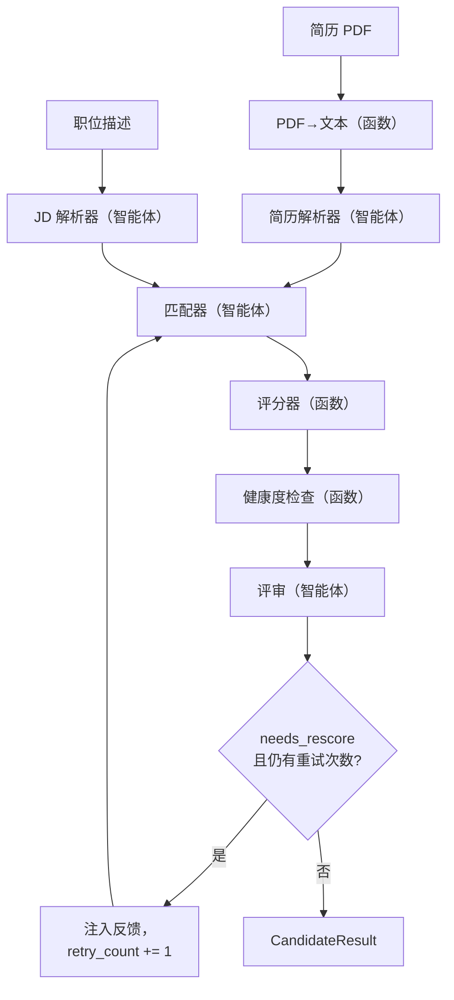

# multi-agent-resume-screener — 架构深度剖析（面试讲解手册）

本文档为长篇技术面试而写，帮助你向面试官端到端地讲解整个系统。它从论证问题本身入手，然后**按照你实际思考的顺序**逐一解释每个设计决策，重点放在架构、权衡取舍，以及面试官最爱追问的"为什么不选 X"的替代方案上。

使用方法：先从头到尾通读一遍，内化整个叙事脉络。面试时可以从任意一节切入。每节末尾都给出了你可以脱口而出的**一句话总结**，以及面试官很可能抛出的**追问**。

---

## 目录

1. [问题本身及其难点](#1-问题本身及其难点)
2. [为什么单次 LLM 调用是错误的方案](#2-为什么单次-llm-调用是错误的方案)
3. [设计哲学：函数 vs. 智能体](#3-设计哲学函数-vs-智能体)
4. [架构总览](#4-架构总览)
5. [共享状态——让系统可组合的契约](#5-共享状态)
6. [阶段 1——PDF 提取（确定性）](#6-阶段-1pdf-提取)
7. [阶段 2 和 3——解析智能体与结构化输出](#7-阶段-2-和-3解析智能体)
8. [阶段 4——匹配器（核心差异点）](#8-阶段-4匹配器)
9. [阶段 5——确定性评分器](#9-阶段-5确定性评分器)
10. [阶段 6——健康度检查器](#10-阶段-6健康度检查器)
11. [阶段 7——评审与自我修正循环](#11-阶段-7评审与自我修正)
12. [基于 LangGraph 的编排](#12-基于-langgraph-的编排)
13. [双角色筛选层](#13-双角色筛选层)
14. [LLM 提供商抽象](#14-llm-提供商抽象)
15. [配置与设置层](#15-配置与设置)
16. [API 层与依赖注入](#16-api-层)
17. [持久化](#17-持久化)
18. [前端](#18-前端)
19. [测试策略](#19-测试策略)
20. [部署](#20-部署)
21. [故障模式与韧性](#21-故障模式与韧性)
22. [后续规划与扩展性](#22-后续规划)
23. [面试快问快答](#23-面试快问快答)

---

## 1. 问题本身及其难点

**问题定义。** 给定一份或多份简历（PDF 格式）和一份职位描述（JD），产出一份*匹配度评估*：每位候选人与该岗位的匹配程度、*为什么*，以及——对于想优化自己简历的候选人——*该改什么*。

它对应两个真实的使用场景：

- **招聘方：**"这个岗位有 200 位申请者。给我排序，并说明理由。"
- **候选人：**"这是我想要的职位。给我的简历打分，并告诉我怎么改进。"

**为什么它确实很难：**

1. **非结构化输入。** PDF 是一种视觉排版，而不是数据。内容完全相同的两份简历，其字节结构可能天差地别。你必须先恢复出结构（技能、经历、项目），才能进行推理。
2. **模糊匹配。**"用 Python 构建过 REST API"应当能匹配上"具备后端开发经验"这条要求，尽管两者没有任何关键词重叠。纯关键词/ATS 匹配会漏掉这一点；这本质上是个语义问题。
3. **依赖上下文。** *同一份*简历对这个岗位是强匹配，对另一个岗位可能很弱。不存在普适的"简历分数"——匹配度永远是相对于某份 JD 而言的。
4. **可解释性是刚需。** 只给一个数字毫无用处，在招聘场景下甚至可以说是不负责任的。招聘方需要证据；候选人需要可执行的理由。系统必须"展示推理过程"。
5. **成本与延迟。** LLM 调用既花钱又花时间。面对 200 份简历，你不能对调用次数毫无节制。

> **一句话总结：**"这是一个非结构化输入、语义匹配的问题：输出必须*可解释*，评分必须*相对于具体职位*，而且在批量规模下还必须保持低成本。"

**你应当预期的追问：**"*为什么不直接用关键词匹配 / ATS？*"→ 因为它过不了第 2 点：表述不同但经验等价的内容会得零分。"*为什么可解释性不可妥协？*"→ 招聘决策需要可审计的依据，而对候选人的反馈本身就是这一侧的核心价值。

---

## 2. 为什么单次 LLM 调用是错误的方案

最朴素的方案是一个大提示词："这是一份简历和一份 JD，返回一个 0–100 的分数。"我刻意否决了它。下面是理由，因为这次*否决*本身就是项目中最重要的一项架构决策。

**单体提示词的问题：**

- **它是黑盒。** 分数错了，你无法判断是推理的*哪个环节*出了问题——解析？匹配？加权？一次不透明的调用无从调试。
- **改一处就可能毁全部。** 为了修评分去调提示词，可能把解析搞坏。完全没有关注点分离。
- **"分数"不确定且不可审计。** LLM 这次调用可能给技能赋 40% 的权重，下次调用变成 25%。你既无法证明数学过程，也无法调优。
- **无法复用。** 如果想把一份简历匹配五个职位，单体方案会把这份简历重复读取、重复解析五次。
- **它把确定性工作与概率性工作混在一起。** 计算加权平均根本不需要 LLM——但单体方案偏要让 LLM 来做，做得又差又贵。

**我选择的替代方案：** 分解为一条**由专职阶段组成的流水线**，每个阶段只负责一件事，且各自可独立检查、独立测试。这与"把上帝函数拆成小函数"是同一种直觉——只是应用到了 LLM 工作流上。

> **一句话总结：**"单个提示词是一个无法调试、无法调优、也无法证明的黑盒。我把它分解成多个阶段，让每一阶段都可以被独立检查、测试和改进——同时让确定性的事情保持确定性。"

**追问：**"*流水线不是意味着更多次 LLM 调用、因此更贵吗？*"→ 净成本上并不是：确定性阶段（评分、健康度检查）用零成本的代码取代了 LLM 的工作，而编排层（第 13 节）会在批量模式下主动把调用次数压到最低。你用每份简历多出的几次调用，换来了可调试性，以及在调用不产生价值的地方*砍掉*调用的能力。

---

## 3. 设计哲学：函数 vs. 智能体

贯穿整个系统的准则：

> **任务确定就用普通函数。只有任务真正需要判断力时，才用 LLM 智能体。**

仅这一条原则就决定了成本、可复现性和可测试性。

| 任务 | 需要判断力吗？ | 实现方式 |
|------|-----------------|----------------|
| PDF → 文本 | 否 | 函数（`pypdf`） |
| 简历文本 → 结构化字段 | 是（章节边界、"技能"的界定） | **智能体** |
| JD 文本 → 结构化要求 | 是（必备 vs 加分项） | **智能体** |
| 简历 ↔ JD 章节匹配 | 是（语义契合度） | **智能体** |
| 分项得分 → 最终得分 | 否（算术运算） | 函数 |
| 简历健康度（链接、数字） | 否（规则） | 函数 |
| 差距 / 建议 / 结论 | 是（自然语言判断） | **智能体** |

**为什么这在技术上很重要：**

- **关键之处保持确定性。** 最终得分是匹配器各分项得分的纯函数。相同输入 → 相同输出，永远如此。你可以用精确断言写单元测试（`assert score == 0.62`）。
- **成本。** 七个阶段中有三个是免费的（不消耗 token）。仅健康度检查一项，如果用 LLM 朴素地实现，每份简历就要多一次调用；用函数实现则是零。
- **无需折腾提示词即可调优。** 想让技能的权重更高？改一个权重常量即可——不用做提示词工程，也不用重新验证 LLM 的行为。

> **一句话总结：**"我把 LLM 当作一种稀缺且不确定的资源。代码能干的事就交给代码。LLM 只保留给三个真正需要判断力的环节：解析、匹配和评审。"

---

## 4. 架构总览



数据路径是：**原始输入 → 结构化输入 → 分章节匹配 → 确定性评分 → 健康度检查 → 评审 →（可选的重试）→ 结果。**

有三点值得注意，它们正是架构上最有意思的地方：

1. **匹配器可以从两个方向到达**——正常的前向边和自我修正循环。正是这一条回边让它成为*图*而非一条直线流水线，也是 LangGraph 在这里物有所值的原因（第 12 节）。
2. **评分和健康度检查夹在两个智能体之间**，但它们本身是纯函数——确定性的核心被夹在智能体流程的中间。
3. **评审把守着循环的入口**，但是否循环这个*决定*由代码做出，而不是由 LLM 决定（第 11 节）。

---

## 5. 共享状态

所有阶段都通过同一个类型化对象 `PipelineState` 通信。这是整个系统的骨架——状态模型设计对了，流水线就能干净地组合；设计错了，每个阶段都得写专门的胶水代码。

```python
class PipelineState(BaseModel):
    # 输入
    resume_raw: ResumeRaw
    jd_raw: JDRaw
    config: PipelineConfig

    # 随阶段运行逐步累积（均为 Optional，按顺序填充）
    resume_structured: StructuredResume | None = None
    jd_structured:     StructuredJD | None = None
    match_result:      MatchResult | None = None
    final_score:       FinalScore | None = None
    hygiene:           HygieneReport | None = None
    critique:          Critique | None = None

    # 自我修正的簿记信息
    retry_count: int = 0

    # 可解释性
    trace:  list[TraceEntry] = []
    errors: list[str] = []
```

**关键设计选择及其理由：**

- **用 Pydantic，而不是字典。** 每个阶段间的载荷都是经过校验的模型。如果匹配器输出了格式错误的分项得分，它会在*边界处*立即报错、错误信息清晰，而不是等到三个阶段之后才抛出一个莫名其妙的 `KeyError`。状态本身也是自解释的——读一遍这个类，就能看懂整个数据流。
- **字段为 `Optional`，逐步填充。** 状态最初只包含输入；每个阶段填充属于自己的那部分。这样一来，部分完成/失败的运行也能被表示出来（一个在评分之后挂掉的运行，其状态仍然有效、可供检查），也让 `CandidateResult.from_state` 可以优雅降级。
- **`retry_count` 存放在状态里，而不是编排器里。** LangGraph 节点是无状态函数；所有循环相关的簿记信息都必须*随状态*传递。这是框架设计的必然结果，也让节点保持纯粹。
- **`trace` 是一等公民字段。** 每个阶段都会追加一条 `TraceEntry`（`agent`、`timestamp`、`note`）。这是可解释性/审计的支柱——到最后，你会得到一份按序排列的日志，精确记录了哪些阶段运行过、各自做出了什么决定。
- **用独立的 `CandidateResult` 作为输出。** 我不会把 `PipelineState` 直接返回给 API 客户端——它携带内部簿记信息（原始文本、重试次数等）。一个干净的 `CandidateResult.from_state()` 投影把公开契约与内部机制解耦开来。这是经典的"不要泄露内部模型"的纪律。

> **一句话总结：**"全系统只有一个类型化、逐步填充的状态对象，每个阶段都读写它。Pydantic 在每个边界做校验；由于节点是无状态的，循环状态也放在它里面；再配一个独立的输出模型，防止内部簿记信息泄露给客户端。"

**追问：**"*为什么重试状态要放在状态对象里？*"→ 因为 LangGraph 节点是状态的纯函数；跨循环不存在节点本地记忆，所以追踪"我重试过了吗"的唯一去处就是状态本身。

---

## 6. 阶段 1——PDF 提取

一个使用 `pypdf` 的确定性函数（`pdf.py`）。它**既接受文件路径，也接受原始字节**——字节是 API 从上传中拿到的形式，路径是 CLI 工具使用的形式。它会压缩过多的空行，返回纯文本。

**值得主动提及的技术点：**

- **通过 `BytesIO` 支持字节或路径。** 上传路径完全不落盘；上传的字节被包进 `BytesIO` 直接交给 `pypdf`。没有临时文件、没有清理逻辑、没有竞态条件。
- **明确的错误分类。** 文件缺失抛出 `FileNotFoundError`；PDF 损坏抛出自定义的 `PDFExtractionError`。API 把它们映射为带逐文件信息的 `422`，让用户知道*哪个*文件失败了、为什么失败。
- **对纯图片 PDF 优雅处理。** 扫描版 PDF 只会产生极少甚至没有文本，而不会崩溃；在下游，空简历只会得到一个空的结构化结果（解析器直接短路，不调用 LLM）。

> **一句话总结：**"确定性实现，同时接受字节或路径，上传全程不落盘；错误分类明确，API 按文件逐一上报。"

---

## 7. 阶段 2 和 3——解析智能体

两个智能体，同一套模式：`parse_resume`（文本 → `StructuredResume`）和 `parse_jd`（文本 → `StructuredJD`）。非结构化文本在这里变成数据。

**这里最重要的技术：结构化输出。**

```python
extractor = llm.with_structured_output(StructuredResume)
result = extractor.invoke([SystemMessage(...), HumanMessage(resume_text)])
```

`with_structured_output(Schema)` 把 Pydantic 模式绑定到模型上，让 LLM 返回**经过校验的对象**，而不是自由文本。底层由提供商通过函数调用 / JSON 模式约束解码来实现。这彻底消除了 LLM 应用中最常见的一类故障——脆弱的 JSON 解析，以及"模型在 JSON 前后夹带说明文字"。

**其他技术决策：**

- **处处使用 `temperature=0.0`。** 提取和评分应当尽可能可复现（在概率模型允许的范围内）。我在客户端工厂里默认把温度设为 0。
- **提示词禁止编造。** 系统提示词明确写着"只提取原文中存在的内容；绝不推断"。被幻觉出来的技能会污染匹配结果。诸如"把逗号分隔的技能拆成单独条目"之类的规则让结构化输出更加规整。
- **空输入短路。** 如果文本为空，函数直接返回空模型，*不调用 LLM*——这是一个不大但真实的成本/健壮性收益，并且有单元测试保障：用一个一被调用就"爆炸"的 LLM 断言它从未被调用。
- **防御性的字典转换。** 某些提供商返回的是字典而不是模型实例；代码会用 `Model.model_validate(result)` 重新校验，从而让行为与具体提供商无关。

> **一句话总结：**"两个解析器都用 `with_structured_output` 直接从模型拿到经过校验的 Pydantic 对象——不做 JSON 解析，也不做修复。温度为零，提示词禁止编造，空输入直接短路、完全不碰 LLM。"

**追问：**"*如果 LLM 返回了无效的结构化输出怎么办？*"→ Pydantic 校验会在边界处抛错；实践中模式约束解码让这种情况很罕见，而字典转换路径则兜底处理各提供商的怪癖。

---

## 8. 阶段 4——匹配器

这是**核心差异点**，也是最有趣的一个智能体。它接收结构化简历 + 结构化 JD，产出 `MatchResult`：每个章节（skills、experience、projects、education）一个 `SubScore`，各含 0–1 的分数、**引用的原文证据**和一句话理由——外加一个 `overall_evidence_quality` 信号。

**为什么用分章节的分项得分，而不是一个数字？**

- **粒度即可解释性。**"经历项 0.30 分，因为岗位要求 3 年经验而候选人只有 3 个月实习"是可以执行的结论。"总分 0.58"不是。
- **与加权分离。** 匹配器只判断*各章节的契合度*，不决定每个章节*有多重要*。那是评分器的职责（第 9 节）。把两者分开意味着我可以重新调权重而不必碰提示词，LLM 也永远不需要做算术。
- **证据是一等公民字段。** 每个分项得分都携带着支持它的简历原文片段。这正是第 1 节"展示推理过程"这一要求的实现基础。

**`overall_evidence_quality` 信号**很微妙，值得专门指出：它是匹配器对证据强度/清晰度的自我报告。它随后会参与自我修正决策（第 11 节）——如果证据较弱，我们就更倾向于重新评估。

**防御性归一化。** 我要求 LLM 每个章节恰好输出一条，但我不会轻信它总能照办。`_normalise_sections` 会去重（每个章节保留第一条）并把缺失的章节补零，因此下游的评分器*总是*能看到完整、可预测的四项。这种"不要轻信模型输出的结构，在代码里强制你的不变量"的纪律，正是玩具与健壮系统的分水岭。

**反馈注入。** 匹配器接受一个可选的 `feedback` 参数。在自我修正重试时，评审的建议会被注入提示词（"上一轮结果置信度较低；请针对这条反馈重新评估"），于是第二次尝试是有据可依的改进，而不是盲目重掷骰子。

> **一句话总结：**"匹配器针对 JD 逐章节独立打分并附引用证据，还自我报告证据质量。它刻意不去决定权重——权重保持确定性。并且我在代码里强制执行"每章节一条"的不变量，而不是轻信模型。"

**追问：**"*怎么防止它虚高分数？*"→ 提示词要求"以证据为依据打分"，并明确"不要奖励 JD 没有要求的技能"；证据是强制项，所以没有证据的虚高分数一眼就可疑（评审也能抓住它）。"*为什么不用嵌入向量 + 余弦相似度做匹配？*"→ 见第 23 节；简短版：嵌入只给你一个相似度数字，没有推理也没有证据，无法满足可解释性要求。

---

## 9. 阶段 5——确定性评分器

一个纯函数，不调用 LLM。正是这一环节让最终数字值得信赖。

```
final = Σ (weight_i × sub_score_i)   for i in {skills, experience, projects, education}
```

默认权重：skills 0.35、experience 0.30、projects 0.25、education 0.10。

**为什么它该是函数而不是智能体——完整论证：**

- **可复现。** 给定一个 `MatchResult`，每次计算出的分数都完全相同。你可以写 `assert score == 0.62`。用 LLM 你做不到。
- **可证明。** 无论在面试中还是对招聘方，我都能把算术过程摊开给人看。响应中包含 `weights_used` 和逐章节的 `breakdown`，因此这个数字完全可以复算。
- **可调。** 权重是配置项，可按请求覆盖。校验器会**把任何覆盖值归一化到总和为 1.0**（同时丢弃未知键；如果传入全零则回退到默认值）。正是这个归一化*保证*了无论调用方传入什么权重，最终得分都落在 `[0, 1]` 区间——这是一个可以拍胸脯保证的不变量。
- **最后再做一次钳制（clamp）**，防止浮点误差导致越界，确保严格落在区间内。

这个阶段约 30 行代码，配了 7 个专门的单测（完美匹配 → 1.0、全零 → 0.0、手工加权和校验、缺失章节处理、自定义权重、确定性）。它之所以最容易做到分毫不差，*恰恰因为*它是确定性的——这正是要点所在。

> **一句话总结：**"最终得分是一个权重归一化的纯加权和，因此可复现、可证明、可调优，且保证落在 [0,1] 区间。我把唯一必须值得信赖的环节从 LLM 手里整个拿了回来。"

---

## 10. 阶段 6——健康度检查器

一个确定性、零 LLM 的模块，做客观的简历检查，与 JD 无关。灵感来自 HackerRank 开源 hiring-agent 中的加分/扣分思路，但属于净室实现（未复制任何代码）。

**它检查什么（全部基于规则/正则）：** 缺失邮箱、GitHub、LinkedIn；占位符链接（`example.com`、`TODO`）；技能单薄或缺失；缺少项目；项目名过于笼统（如"项目一"）；经历描述没有数字（影响未量化）；缺少教育背景。它返回一个 0–1 的健康度得分（每个问题按严重程度加权扣分）、问题清单以及亮点。

**关键的架构决策：健康度只是*建议性*的，不计入得分。**

我刻意把健康度排除在 JD 匹配得分**之外**。理由是：匹配得分应该只表达一件事——"与这份工作的契合度"。把"你的简历没有 LinkedIn 链接"掺进来会污染这个信号。健康度改为输入到评审的建议中，并作为一个独立数字呈现给候选人。这样，*岗位契合度*和*简历质量*这两个正交的关注点就被干净地分开了。

**这个阶段为什么存在**（面试中主动讲出来会很加分）：它具体展示了函数 vs. 智能体的哲学。"这份简历有没有 GitHub 链接？"需要零智能——一个正则就能确定性地免费回答。用 LLM 来做只会更慢、更贵，还*更不*可靠。

> **一句话总结：**"基于规则/正则的确定性简历质量检查，只提供建议——它们进入反馈，但绝不碰岗位匹配得分，因为我要让那个得分只表达一件事。"

---

## 11. 阶段 7——评审与自我修正

最后一个智能体。它审阅一切——JD、简历、带证据的分章节得分、最终得分以及健康度报告——然后产出 `gaps`、`suggestions`、一个 `verdict`（强/中/弱匹配）以及 `confidence_in_scoring`。

**本阶段最重要的设计决策：是否自我修正这个*决定*是确定性的，不由 LLM 做出。**

```python
needs_rescore = (
    out.confidence_in_scoring < threshold
    or match_result.overall_evidence_quality < threshold
)
```

LLM 提供*判断所需的输入*（它的置信度、匹配器的证据质量），但决定是否循环的**规则**写在代码里。我甚至把它落实到了类型上：LLM 被要求输出一个内部的 `_CriticLLMOutput` 模式，其中**不包含 `needs_rescore`**——这个字段是事后计算出来、再补进公开的 `Critique` 的。所以模型在字面意义上无法决定循环；它只能提供规则所消费的数字。

**为什么这很重要：**

- **可预测。** 循环行为由一个可调阈值（默认 0.6）控制，而不是看 LLM 的"心情"。我能精确推理重试何时触发。
- **可调。** 调低阈值 → 重试更少（更便宜）；调高阈值 → 更谨慎（更昂贵）。一个旋钮，不用改提示词。
- **必然终止。** 再配合重试上限（第 12 节），循环可以证明一定会终止。

**循环本身：** 如果 `needs_rescore` 为真且尚未达到 `max_retries`（默认 1），控制流就带着评审建议（作为反馈注入）返回匹配器。做一次谨慎的重新评估，然后无论如何都定稿。

> **一句话总结：**"评审负责给出判断，但要不要重新评估由代码里一个确定性的阈值说了算——我甚至把 `needs_rescore` 排除在 LLM 的输出模式之外，让模型根本无法决定循环。这让智能体循环可预测、可调优，并且保证终止。"

**追问（非常常见）：**"*为什么重试上限是 1？为什么不循环到有信心为止？*"→ 对概率模型做无界循环是成本和延迟风险，而且多轮之后很少再有实质性收敛；一次有据可依的重试就能拿到大部分收益。上限是配置项，如果真有证据支持更多轮次，改一行配置就行。

---

## 12. 基于 LangGraph 的编排

各阶段被组装进一个 `StateGraph`：节点就是各阶段的函数，边定义了执行流。大部分边是线性的；最有意思的是评审之后的一条**条件边**。

```python
graph.add_conditional_edges(
    "critic",
    route_after_critic,          # 返回 "retry" 或 "end"
    {"retry": "prepare_retry", "end": END},
)
graph.add_edge("prepare_retry", "match")   # 回边
```

**为什么用 LangGraph，而不是按顺序直接调用函数？** 这是面试官*必定*会问的问题，而坦诚的答案恰恰是最有力的：

- 纯线性的流水线确实*不需要*图框架——直接调用普通函数是对的。**LangGraph 的正当性来自那条条件自我修正边。** 一旦存在一个能根据运行时状态把控制路由回先前节点的节点，你就拥有了状态机，而图框架能把这件事做得干干净净：显式的节点、显式的条件路由、集中式的状态传递，以及一张编译后可供检查的图。
- 它还**白送状态管理**——每个节点返回一个部分更新的字典，框架把它合并进状态，因此节点始终是输入状态的纯函数。

**两个我实际撞上并解决的技术细节：**

1. **节点名不能与状态字段名冲突。** 我最初把健康度节点命名为 `hygiene`，与状态字段 `hygiene` 撞名；LangGraph 报错 `'hygiene' is already being used as a state key`。我把节点改名为 `check_hygiene`。一个不错的"我读过框架的约束"的故事。
2. **不写自定义 reducer 也能累积 trace。** 每个节点返回 `{"trace": state.trace + [new_entry]}`——先读当前 trace，再返回一个延长后的副本。这样审计日志就能跨节点（以及跨循环迭代）累积，而无需自定义 channel reducer。解析节点是幂等的（如果已解析过就提前返回 `{}`），所以重试不会重新解析。

**幂等节点让 JD 可以复用。** 解析节点会检查"我是不是已经有值了？"，有就跳过。正因如此，批量层才能只解析一次 JD，然后注入每份简历的状态——每份简历的 JD 解析节点发现它已设置，直接空操作。干净利落，而且在批量为 N 时省掉 N-1 次 JD 解析。

> **一句话总结：**"LangGraph 的价值来自且仅来自一条边——回到匹配器的条件循环。这条回边让系统成为状态机，而框架给了我显式节点、条件路由和自动状态传递。纯线性流水线用不上它，这一点我会直说。"

---

## 13. 双角色筛选层

在单简历图之上是 `screen()`——它把"运行一份简历"升级为"运行一次候选人或招聘方请求"的编排层。并发与成本控制都住在这里。

```python
config = config or PipelineConfig()
jd_structured = parse_jd(jd, llm=llm)          # JD 只解析一次
pipeline = build_pipeline(llm=llm)

fast = config.mode == "recruiter" and config.critic_mode == "fast"
run_config = config.model_copy(update={"enable_critic": not fast})

states = await asyncio.gather(                 # 所有简历并发执行
    *(_run_one(pipeline, r, jd, jd_structured, run_config) for r in resumes)
)

if fast:                                        # 只评审前 K 名
    ranked = sorted(states, key=score, reverse=True)
    for s in ranked[:config.critic_top_k]:
        s.critique = critique(...)

candidates = sorted(map(CandidateResult.from_state, states),
                    key=lambda c: c.score, reverse=True)
```

**这里的三个技巧，各有其理由：**

1. **JD 只解析一次。** 同一请求中所有简历面对的 JD 完全相同。只解析一次再注入（幂等节点，第 12 节），在批量为 N 时省下 N-1 次 LLM 调用。200 份简历就是省下 199 次调用。
2. **用 `asyncio.gather` 实现并发。** 每份简历的流水线相互独立，所以可以并发执行。`pipeline.invoke` 是阻塞调用，所以我在 `_run_one` 里用 `asyncio.to_thread` 把它挪出事件循环——这正是让 gather 真正并行、而不是"多绕几步的串行"的关键。逐简历独立还意味着一份坏简历不会毒害其他简历，且每份都可以独立重试。
3. **fast vs full 评审——成本杠杆。** 在 `full` 模式下，评审随每份简历内联运行。在 `fast` 模式下，我把 `enable_critic` 置为 `False`（一条条件图边跳过内联评审），先给所有人打分，*然后*只评审前 K 名。在 200 份简历、`critic_top_k=5` 的批次上，这省下了约 195 次评审调用。这就是"我在规模化场景下考虑过成本"的故事。

**为什么逐份简历处理，而不是把所有简历塞进一个巨型提示词？** 三个理由：可调试性（一次失败被局部隔离）、没有长上下文的近因偏差（LLM 会过度看重长提示词末尾附近的内容），以及天然的并行性。这也与真实的排名系统（Greenhouse、Lever）的做法一致：先独立给候选人打分再排序，而不是让模型一口气比较 200 份简历。

> **一句话总结：**"批量层只解析一次 JD，用 asyncio 并发跑所有简历；fast 模式下给所有人打分、但只评审前 K 名——把 O(N) 的评审成本变成 O(K)。逐简历隔离还消除了长上下文近因偏差，并让故障保持局部化。"

---

## 14. LLM 提供商抽象

智能体从不导入具体的 LLM 类。它们调用一个工厂：

```python
def get_chat_model(*, temperature=0.0, settings=None, **kwargs) -> BaseChatModel:
    provider = settings.llm_provider.strip().lower()
    if provider not in DEFAULT_MODELS:
        raise LLMConfigError(...)
    model = settings.llm_model or DEFAULT_MODELS[provider]
    if provider == "gemini": return _build_gemini(...)
    if provider == "groq":   return _build_groq(...)
```

**架构原则：依赖倒置。** 每个智能体只依赖 LangChain 的抽象 `BaseChatModel`，从不依赖 `ChatGoogleGenerativeAI` 或 `ChatGroq`。由于所有提供商实现同一接口——关键在于都包括 `.with_structured_output()`——切换提供商只是**改配置，任何智能体代码零改动**。

**技术细节：**

- **按提供商懒加载导入。** `langchain_google_genai` 只在 `_build_gemini` 内部导入，`langchain_groq` 只在 `_build_groq` 内部导入。只部署 Groq 的环境无需安装 Gemini 包，反之亦然。
- **清晰的配置错误。** 缺少密钥 → 抛出 `LLMConfigError`，指明具体的环境变量名以及去哪里申请密钥。API 把它映射为 `503`。
- **`temperature=0.0` 的默认值**在这里集中设置，因此每个智能体默认继承确定性解码，除非它主动退出。

**这个抽象是真的派上了用场，不是纸上谈兵。** 项目进行到一半时发现 Gemini 免费额度每天只有约 20 次请求——对公开演示来说太低了。把整个系统切到 Groq（Llama 3.3 70B，每天约 14,400 次）只改了*一个环境变量*。任何智能体代码都没动。这是抽象在真实约束下证明自身价值的例子——比起"我加这层是为了灵活性"，这是强得多的面试故事。

> **一句话总结：**"智能体依赖抽象的 `BaseChatModel` 而非具体提供商，所以换 LLM 只是改一个环境变量。我验证过：当 Gemini 免费额度太小，我把整个应用迁到 Groq，一个智能体都没碰。"

---

## 15. 配置与设置

`settings.py` 用 `pydantic-settings` 从环境变量 / `.env` 加载类型化配置：提供商、模型、API 密钥、数据库路径、日志级别。它用 `@lru_cache` 包装，因此 `.env` 只读取一次，同一个 `Settings` 实例被复用。

`PipelineConfig` 是*按请求*生效的配置（mode、critic_mode、critic_top_k、weights、max_retries、confidence_threshold）。这种切分是有意的：**`Settings` = 部署级（环境变量），`PipelineConfig` = 请求级（API 参数）。** `PipelineConfig` 上的校验器就是权重归一化的所在，因此 `[0,1]` 的得分保证在配置构造时就被强制执行——早于任何评分运行。

> **一句话总结：**"两层配置：环境级的 Settings（带缓存、只读一次）和请求级的 PipelineConfig，后者的校验器提前归一化权重，于是得分区间的不变量在任何阶段运行之前就已成立。"

---

## 16. API 层

FastAPI。端点：`GET /`（UI）、`GET /health`、`POST /screen`、`GET /runs/{id}`、`GET /runs`，外加 `/docs`（自动生成的 Swagger）。

**架构上有意思的点：**

- **LLM 与存储的依赖注入。** `get_llm` 和 `get_store` 都是 FastAPI 依赖项。生产环境中它们返回真实提供商 / 基于文件的 SQLite 存储；测试中我通过 `app.dependency_overrides` 覆盖它们，注入**假 LLM** 和临时文件数据库。正是这一点让整个 API 可以离线测试，不依赖任何网络和密钥（第 19 节）。
- **校验先行、分层错误映射。** 我在读取文件*之前*就构造 `PipelineConfig`，因此非法的 `mode` 会立刻以 `422` 快速失败。每份 PDF 在循环中逐个提取，失败时按文件返回 `422`。密钥缺失引发的 `LLMConfigError` 映射为 `503`。客户端拿到的永远是具体、可行动的状态码 + 消息。
- **异步端点，阻塞工作移交给线程。** 端点是 `async` 的；CPU/IO 阻塞型工作（`store.save`、阻塞式的 `pipeline.invoke`）被推给线程执行，避免事件循环被饿死。
- **多部分上传。** `resumes: list[UploadFile]` 在单个请求里接受一份或多份 PDF——同一个端点服务两种角色。

> **一句话总结：**"FastAPI 把 LLM 和数据存储都藏在依赖注入后面，这正是我能用假模型离线测试整个 API 的原因。校验先于文件 I/O，每种失败都映射到具体的状态码和可行动的消息。"

---

## 17. 持久化

`storage/runs.py`——基于标准库 `sqlite3` 的小型 `RunStore`（无额外依赖）。每次运行保存为一行 JSON，以 UUID 形式的 `run_id` 为键，另设 `created_at`、`mode`、`job_title`、`n_candidates` 几列，便于低成本的列表查询。

**技术选择：**

- **标准库 sqlite3，每次操作新建连接。** SQLite 连接跨线程共享并不安全；每次操作开一个新连接，存储就能被 FastAPI 的工作线程安全调用，而无需连接池。
- **完整结果以 JSON 存储。** 我不对候选人做关系型查询；我存取的是完整的运行记录。以 `run_id` 为键的 JSON 块，加上几个带索引的摘要列，重量刚好——不过早设计模式。
- **明确拒绝 `:memory:`**，并给出友好的报错——因为在"每次操作一个连接"的设计下，内存数据库会静默丢数据。这道护栏避免了一个隐蔽的坑。

> **一句话总结：**"一个小巧的 SQLite 存储，只用标准库，每次操作一个连接，因此在 FastAPI 下线程安全。运行记录以 UUID 为键存成 JSON 块，配几个用于列表的摘要列——体量刚好，不过早设计模式。"

---

## 18. 前端

一个零依赖的单页 UI（`index.html`、`style.css`、`app.js`），由 FastAPI 自己在 `/` 路径上伺服，静态资源放在 `/static` 下。没有 React，没有构建步骤。

**为什么是静态的、由服务端伺服、不用框架：**

- **单一制品。** UI 随 API 打包在*同一个*包/容器里（通过 `package-data` 接线）。一次部署、一个源——没有 CORS，没有独立的前端主机，没有构建流水线。
- **原生 JS，XSS 安全。** 所有动态渲染都用 `textContent`，绝不用 `innerHTML`，而数据最终来自用户上传的简历——所以一份含有 `<script>` 的简历无法注入任何东西。
- **它是演示 UI，不是产品本体。** 产品是那条流水线。UI 只是让流水线可触摸的最薄一层（上传、切换模式、查看带分解条的得分/差距/建议）。在这里上 React 工具链是把力气花错了地方。

> **一句话总结：**"零构建的静态 UI 由 API 自己伺服，因此是单一制品，没有 CORS，也没有独立主机。原生 JS 用 textContent 渲染以保证 XSS 安全。流水线才是产品，UI 是刻意保持纤薄的一层。"

---

## 19. 测试策略

**70 个测试，完全离线，外加真实环境验证。** 策略本身才是有意思的部分。

- **一个模仿真实接口的假 LLM。** 测试注入一个假的实现，其 `with_structured_output(Schema).invoke()` 返回预设的模型对象。这样跑的是*真实的*智能体代码路径——提示词构造、归一化、字典转换、反馈注入——而全程没有一次网络调用、不需要任何 API 密钥。CI 快速、确定、免费。
- **图/编排测试用的路由型假 LLM。** 一个更聪明的假实现按所请求的模式分发，因此同一个假 LLM 就能驱动解析器 + 匹配器 + 评审跑完整个流水线——让我能把自我修正循环、"JD 只解析一次"的不变量、以及 fast 模式的前 K 名评审，都做成纯离线测试。
- **针对函数的确定性测试。** 评分器和健康度检查使用精确值断言（`assert score == 0.62`）——只有*因为*它们是确定性的才可能做到，这本身就验证了"函数 vs. 智能体"这整套论点。
- **通过 `TestClient` + 依赖覆盖做 API 测试。** 完整的 HTTP 路径（多部分上传 → 筛选 → 持久化 → 检索）用一个真实的（微小的、手工生成的）PDF 加上通过依赖注入的假 LLM 来测试。
- **每个阶段都做过真实环境验证。** 离线测试套件之外，开发期间每个智能体都连真实 LLM 跑过，部署后的应用也通过 HTTP 做了端到端冒烟测试。

> **一句话总结：**"每个阶段都通过注入一个实现相同接口的假 LLM 来离线测试，因此测的是真实代码路径，零网络、零密钥。确定性阶段用精确值断言。之后我又对每个阶段做了真实环境验证，并对部署后的应用做了 HTTP 冒烟测试。"

**追问：**"*不确定的 LLM 行为怎么测？*"→ 我不测模型本身；我用一个返回受控输出的假实现来测*围绕它的我的代码*。模型质量另行通过真实运行来验证。

---

## 20. 部署

已容器化（`Dockerfile`），部署到 **Hugging Face Spaces**（Docker SDK），运行在 Groq 上。README 的 front-matter 兼作 Space 配置；同一个容器同时服务 API + UI + SQLite。

**值得主动提出的点：**

- **一个容器，整个应用。** API、静态 UI 和 SQLite 文件都装在同一个镜像里——凡是能跑 Docker 的地方都能轻松运行。
- **感知 `$PORT`，src 布局可编辑安装。** 镜像安装本包（`pip install -e ".[groq]"`）并启动 uvicorn 绑定 `$PORT`——PaaS 主机正是通过它注入端口的。
- **感知临时磁盘。** 免费主机的磁盘是临时的，所以 SQLite 路径默认为 `/tmp/runs.db`；重新部署时运行历史会重置——对演示而言无伤大雅，这是一个有意识的取舍而非疏忽。
- **有意选择 HF Spaces。** 它 48 小时的闲置休眠（相比之下 Render 只有 15 分钟）让作品集链接对访问者始终保持"温热"，而且 AI Space 在评审者眼中也更契合主题。（Render 免费档还不允许保活探测，所以"定时 ping 一下"并不可行——这是另一个经过权衡的取舍。）

> **一句话总结：**"单个容器——API、UI 和 SQLite——跑在 Hugging Face Spaces 上，后端是 Groq。感知端口、感知临时磁盘，并且我是在 48 小时保温窗口和 AI 作品集契合度的考量下，刻意选了 HF 而非 Render。"

---

## 21. 故障模式与韧性

值得主动讲出来，因为它体现了生产环境的思维方式：

- **无法读取 / 纯图片的 PDF** → `PDFExtractionError` → 按文件返回 `422`；空文本让解析器直接短路（不浪费 LLM 调用）。
- **格式错误的结构化输出** → 在边界做 Pydantic 校验；字典转换路径兜底处理提供商的怪癖。
- **API 密钥缺失/无效** → `LLMConfigError` → `503`，附清晰的消息。
- **限流** → 提供商客户端对 `429` 做退避/重试；有了抽象层，*修复手段*（换提供商）只是改配置。
- **自我修正不收敛** → 硬性重试上限保证终止。
- **批次中的一份坏简历** → 逐简历隔离意味着其他简历不受影响，故障保持局部。
- **得分越界** → 结构上不可能（归一化权重 + 钳制）。

> **一句话总结：**"每一层都有明确的故障预案——坏 PDF、畸形输出、缺密钥、限流、循环不收敛、单份坏简历——而得分区间的不变量从构造上就不可能被违反。"

---

## 22. 后续规划

诚实且按优先级排列的路线图（面试官喜欢清楚自己系统局限的候选人）：

- **嵌入向量作预过滤。** 在超大批量下，可以先用便宜的嵌入相似度做一遍预排序/剪枝，再进入（更贵的）智能体匹配——即"先检索后重排"（retrieval-then-rerank）的混合方案。智能体保留给最上面那一段，因为那里证据才重要。
- **缓存已解析的简历。** 解析过一次的简历可以缓存起来（按内容哈希），之后匹配多个职位时无需重新解析——解析器/匹配器的拆分当初就是照着这个方向设计的。
- **流式返回结果。** 对招聘方的大批量请求，候选人一完成就流式返回，而不是等整个 `gather` 结束。
- **鉴权 + 按用户的历史记录。** 真正面向候选人/招聘方的产品需要账号体系和 RBAC；我把它明确划为第二阶段，以便先交付核心功能。
- **UI 中结构化的证据高亮。** 匹配器已经返回逐章节的证据片段；把它们内联展示出来（类似彩色标注的简历查看器）是纯前端的增量。
- **可观测性。** 逐阶段的 token/延迟指标（`trace` 已留好钩子——`tokens_used`）导出到 Prometheus。

> **一句话总结：**"我清楚下一步棋：超大批次用嵌入预过滤、按内容哈希缓存解析结果、流式返回、加账号体系——而且架构里已经留好了接缝（解析器/匹配器的拆分、trace 的 token 钩子），加进来都很干净。"

---

## 23. 面试快问快答

**问：为什么不直接用嵌入向量 + 余弦相似度做匹配？**
嵌入只给一个相似度*数字*，没有推理也没有证据——这过不了可解释性这一关（第 1 节）。在大规模场景下我会把嵌入用作*预过滤*（第 22 节），但打分本身需要一个能引用证据、能区分"必备还是加分"的智能体。两全其美：用嵌入检索，用智能体重排/解释。

**问：为什么用 LangGraph 而不是普通函数调用？**
只有那条条件自我修正边能证明它的必要性（第 12 节）。这一点我会坦率讲出来——纯线性流水线用不上图框架。正是回边让它成为状态机；LangGraph 给了我显式节点、条件路由和自动的状态传递。

**问：为什么评分用函数而不用 LLM？**
这样它才可复现、可证明、可调优，且被约束在 `[0,1]` 区间内（第 9 节）。LLM 负责产出分项得分（判断）；算术保持确定性。

**问：规模化时怎么控制成本？**
JD 只解析一次；简历并发执行；`fast` 模式只评审前 K 名，把 O(N) 的评审成本变成 O(K)（第 13 节）。再加上七个阶段里有三个完全不使用 LLM。

**问：怎么防止 LLM 幻觉出技能？**
提示词禁止编造；结构化输出约束输出形状；每个分项得分必须附证据，无依据的说法一眼可见；评审能标记低置信度的打分并触发一次有据可依的重新评估。

**问：依赖 LLM 的东西怎么测试？**
依赖注入 + 一个实现相同 `with_structured_output` 接口的假 LLM。70 个离线测试跑的是真实代码路径，零网络（第 19 节）。

**问：遇到损坏的 PDF / 缺失的密钥 / 限流会发生什么？**
分别是 `422` / `503` / 提供商退避——见第 21 节。提供商抽象让限流的修复变成改一个环境变量。

**问：为什么要两个配置对象？**
`Settings` 是部署级的（环境变量、带缓存）；`PipelineConfig` 是请求级的（API 参数），其校验器提前强制执行权重归一化不变量（第 15 节）。

**问：最大的弱点是什么？**
在超大批量下，逐简历的智能体匹配是成本大头；下一版迭代是加嵌入预过滤，让智能体只跑最有希望的那一段（第 22 节）。解析器/匹配器的拆分当初就是为了这个扩展能干净落地而设计的。

---

## 60 秒版本（如果对方*真的*限时）

> "它针对具体职位筛选简历，并解释*为什么*。我否决了单提示词方案，因为它是一个无法调优的黑盒，而是把它分解成一条流水线：PDF 提取、评分、简历健康度检查用确定性函数；只有解析、语义匹配和评审用 LLM 智能体。匹配器针对 JD 逐章节打分并附引用证据；一个纯函数把它们变成可证明、有界的最终得分；评审产出差距和建议。评审还把守着一条回到匹配器的、由阈值确定性控制的单次自我修正循环——正是这条回边让我选择了 LangGraph。在它之上，批量层只解析一次 JD、并发运行各简历，并在 fast 模式下只评审前 K 名以控制成本。LLM 藏在提供商抽象之后——当我撞上限流时，用一个环境变量就把整个应用从 Gemini 迁到了 Groq，证明了它的价值。整套系统通过假 LLM 做了 70 个离线测试，配上一个纤薄的静态 UI 和 SQLite 持久化，以单个容器部署在 Hugging Face Spaces 上。"
