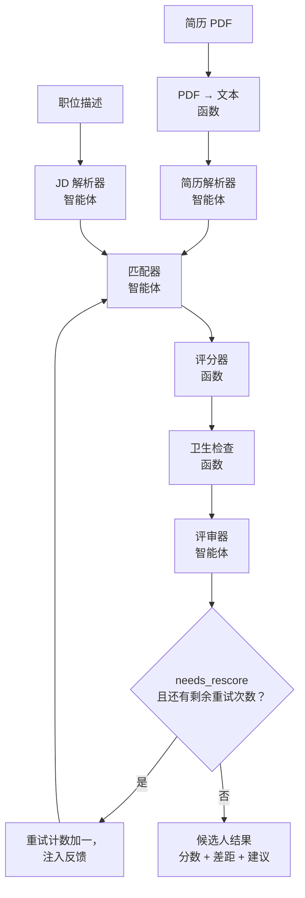
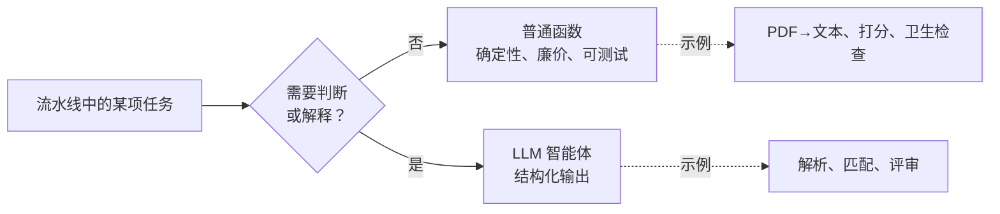
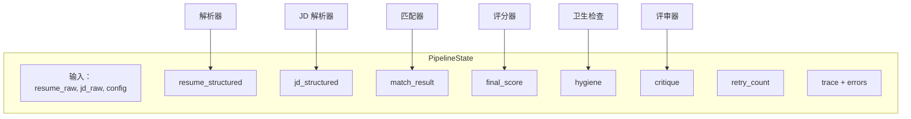
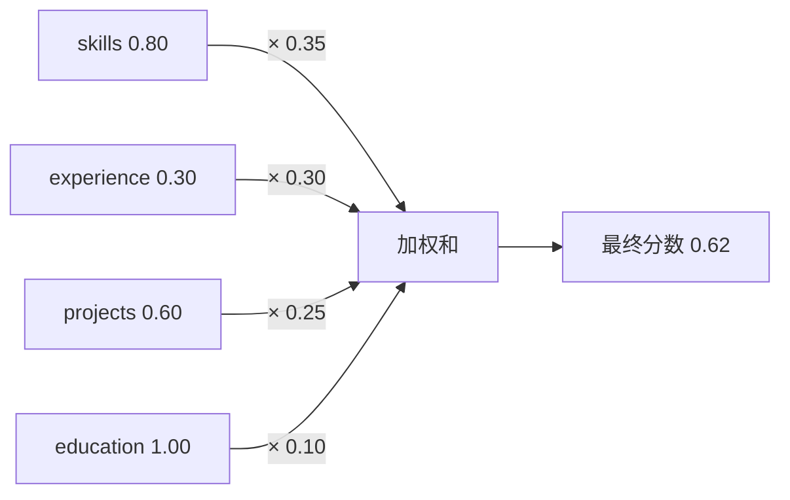
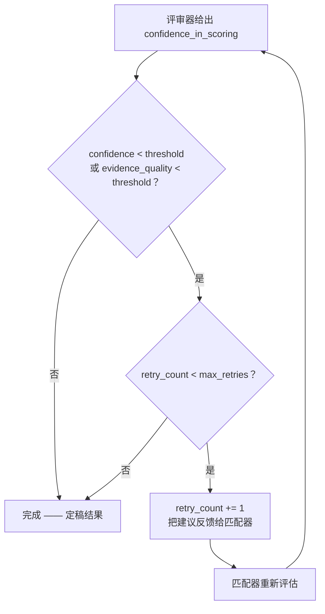
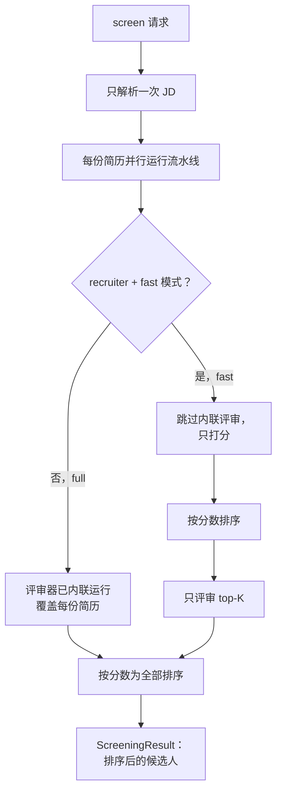
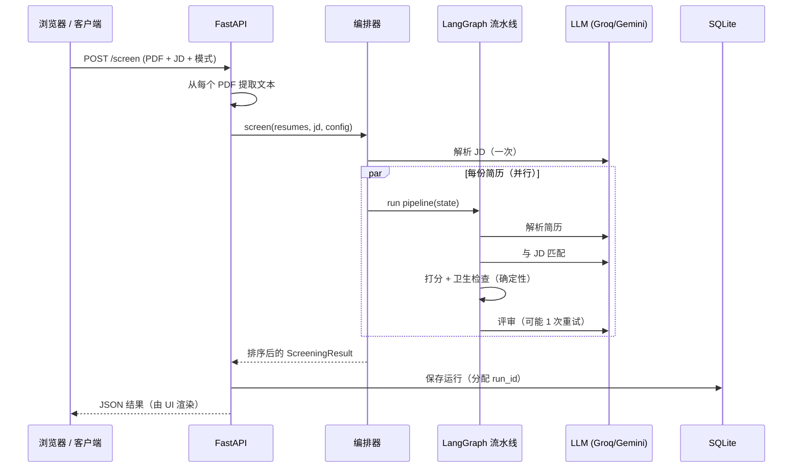
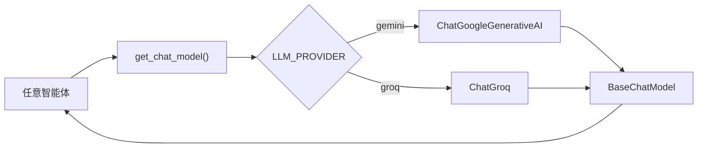
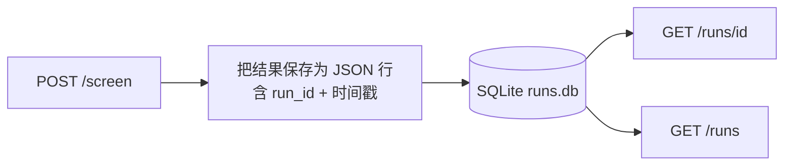
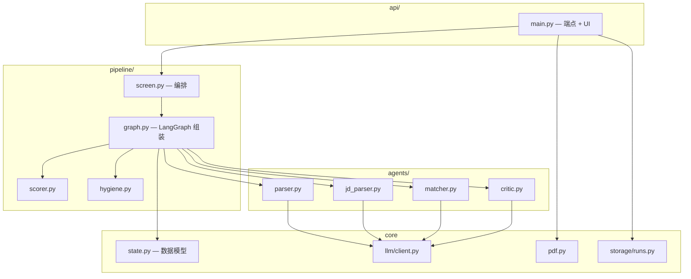

# multi-agent-resume-screener — 功能与工作原理

这是一份完整指南，介绍 multi-agent-resume-screener 能做什么以及内部如何运作。第 1 部分逐项列出功能特性；第 2 部分借助流程图讲解内部机制。

> 下面的图表使用 [Mermaid](https://mermaid.js.org/) 绘制，GitHub 会自动渲染。如果你阅读本文的环境不支持渲染 Mermaid，图表周围的文字对每张图都有说明。

---

# 第 1 部分 — 功能特性

## 1. 两种角色，一套引擎

| 角色 | 模式 | 你提供什么 | 你得到什么 |
|---------|------|---------------|--------------|
| **候选人（Candidate）** | `candidate` | 1 份简历 + 1 份职位描述 | 一个匹配分数，以及针对该职位改进简历的差距分析和具体建议 |
| **招聘者（Recruiter）** | `recruiter` | N 份简历 + 1 份职位描述 | 一份排序后的候选名单，每份都带分数、证据和结论 |

两种角色运行**同一套**底层流水线，区别只在外围的编排方式。

## 2. 六阶段智能体流水线

每份简历都要经过六个专门阶段。当任务是确定性的，阶段就是普通的**函数**；只有当任务需要判断力时，才是 **LLM 智能体**——这样既压低成本，又保证行为可复现。

| # | 阶段 | 类型 | 职责 |
|---|-------|------|----------------|
| 1 | **PDF → 文本** | 函数 | 从上传的 PDF 中提取原始文本 |
| 2 | **简历解析器** | 智能体 | 把简历文本转换为结构化字段 |
| 3 | **JD 解析器** | 智能体 | 把职位描述转换为结构化要求 |
| 4 | **匹配器** | 智能体 | 对照 JD 为每个板块打分，并给出引用证据 |
| 5 | **评分器** | 函数 | 把各子分合成为一个确定性的加权分数 |
| 6 | **卫生检查** | 函数 | 客观的简历质量检查（链接、数字等） |
| 7 | **评审器** | 智能体 | 差距、建议、结论，以及置信度检查 |

## 3. 按板块打分并附证据

匹配器不是给出一个不透明的数字，而是**独立地为四个板块打分**：

- **skills（技能）**：默认权重 35%
- **experience（经验）**：30%
- **projects（项目）**：25%
- **education（教育）**：10%

每个板块都附带引自简历的**证据**和一两句话的**理由**，因此你始终能看到分数是*为什么*给出的。

## 4. 确定性、可调的最终分数

最终分数就是一个简单的加权和——不是 LLM 的猜测：

```
final = (0.35 × skills) + (0.30 × experience) + (0.25 × projects) + (0.10 × education)
```

- **可复现** — 相同的输入永远得到相同的数字。
- **可调** — 权重可按请求覆盖，并会自动归一化到总和为 1.0，因此分数始终落在 `[0, 1]` 区间内。
- **可审计** — 响应中包含所使用的确切权重和各板块得分明细。

## 5. JD 感知匹配（核心差异点）

分数反映的是与**这个具体职位**的匹配程度，而不是一套通用的简历评分标准。匹配器知道 JD 中哪些是必备技能、哪些是加分技能、最低经验年限、职责以及任职资格，并据此评判候选人。

## 6. 自修正循环

打分完成后，评审器会报告它对"这些分数是否有充分依据"的**置信度**。如果置信度（或匹配器的证据质量）低于阈值，流水线会**回跳到匹配器一次**，进行更仔细的重新评估，并把评审器的建议作为指导注入。重试次数有硬性上限（默认 1），因此绝不会无限循环。

## 7. 简历卫生检查（确定性，零 LLM）

与职位描述无关的客观、基于规则的检查：

- 缺少邮箱 / GitHub / LinkedIn 链接
- 占位或示例 URL（如 `example.com`、`TODO`）
- 技能列表过于单薄或缺失
- 缺少项目，或项目名过于笼统（如 "Project 1"）
- 经历条目没有量化成果（无数字）
- 缺少教育经历部分

这些检查会产出一个**卫生分数**（0–1）和一份问题清单。卫生检查是**建议性**的：它为评审器的建议提供输入并展示给候选人，但**不会**改变 JD 匹配分数（保证该分数只反映职位匹配度）。

## 8. 评审器反馈

对每位候选人，评审器返回：

- **gaps（差距）** — 候选人未明确满足的具体 JD 要求
- **suggestions（建议）** — 可操作的建议（包括相关的卫生检查修复项）
- **verdict（结论）** — `strong_fit`、`moderate_fit` 或 `weak_fit`
- **confidence_in_scoring** — 驱动自修正决策

## 9. 成本控制（fast 与 full 评审模式）

| 评审模式 | 行为 | 适用场景 |
|-------------|-----------|-------------|
| `full` | 评审**每一份**简历 | 候选人模式，或小批量场景 |
| `fast` | 所有人都打分，只评审 **top-K** | 大批量招聘场景——节省 LLM 调用 |

`critic_top_k`（默认 5）控制 fast 模式下评审排名前多少位候选人。

## 10. 并行筛选

在招聘者模式下，JD 只解析**一次**并在所有简历间复用，简历则**并发**处理（`asyncio`）。这样更快，也避免了把多份简历塞进一次 LLM 调用会带来的顺序偏差。

## 11. 与提供商无关的 LLM

LLM 由配置决定，而非硬编码。切换提供商只需改一行环境变量，**零代码改动**：

| 提供商 | 默认模型 | 免费额度余量 |
|----------|---------------|--------------------|
| **Gemini** | `gemini-2.5-flash` | 约 20 次请求/天 |
| **Groq** | `llama-3.3-70b-versatile` | 约 14,400 次请求/天 |

在线演示运行在 Groq 上，以获得更充足的额度。

## 12. 可解释性 / 审计追踪

每次运行都会记录一条 **trace**——每个执行过的阶段记一条（附注如 `score=0.62` 或 `retry=1`）。结合各板块的证据，任何结果都可以被完整解释和调试。

## 13. 运行持久化

每次筛选运行都会以唯一的 `run_id` 保存到 **SQLite**，结果之后可以取回或列出。无需配置任何外部数据库。

## 14. HTTP API

| 方法 | 路径 | 说明 |
|--------|------|-------------|
| `GET` | `/` | Web UI（单页） |
| `GET` | `/health` | 存活检查 |
| `POST` | `/screen` | 用 JD 筛选简历 PDF；返回排序结果 |
| `GET` | `/runs/{id}` | 取回一条已存储的运行记录 |
| `GET` | `/runs` | 列出最近的运行记录 |
| `GET` | `/docs` | 交互式 Swagger UI |

## 15. Web UI

一个简洁、零依赖的单页前端（由 API 自身提供）：职位描述输入框、模式与评审开关、多 PDF 上传，以及结果视图——包含分数、结论徽章、各板块得分条形图、差距、建议和卫生检查结果。无构建步骤，无框架。

## 16. 健壮的输入处理

- 对空 JD、缺失文件、无法读取的 PDF 或非法模式值，返回清晰的 `422` 错误。
- 若 LLM 密钥缺失或配置错误，返回 `503` 并附有帮助信息。
- 空 PDF 或纯图片 PDF 也能妥善处理，不会崩溃。

## 17. 经过测试与 lint 检查

70 个离线测试（使用假 LLM，运行它们不需要 API 密钥或网络），外加 `ruff` lint 检查。每个阶段也都用真实 LLM 做过实测验证。

## 18. 一键部署

项目自带 `Dockerfile` 和 Hugging Face Spaces 配置（以及 Render blueprint）。整个应用——API + UI + 存储——都在单个容器中运行。

---

# 第 2 部分 — 工作原理

## 2.1 顶层流水线

对于单份简历，各阶段按顺序执行，另有一个由评审器驱动的、可选的回跳到匹配器的循环：



**为什么采用这种结构：**

- **解析器**与**匹配器**相互分离，这样一份简历只需解析一次，就能与多个职位匹配（或在一批任务中复用）。
- 匹配器返回的是**子分 + 证据**，而不是最终数字，因此打分保持确定性且可调。
- **评分器**是纯函数——最终数字总是可证明的。
- **评审器**最后运行，并掌管自修正循环的开关。

## 2.2 函数 vs. 智能体的决策

最重要的一条设计原则：只在需要判断力时才动用 LLM。



这让系统保持低成本（更少的 LLM 调用）、可复现（尽可能确定性），并且只在真正增值的地方才"智能体化"。

## 2.3 共享状态

每个阶段都读写同一个共享的、有类型的对象——`PipelineState`。它最初只包含输入，随着流水线运行不断累积结果：



使用显式的 Pydantic 模型（而不是松散的字典）意味着框架会校验阶段之间传递的数据，整条流水线也自带文档。

## 2.4 评分的计算

匹配器为每个板块各输出一个子分；评分器负责把它们合成起来。



计算示例：
`(0.80×0.35) + (0.30×0.30) + (0.60×0.25) + (1.00×0.10) = 0.62`。

权重可按请求覆盖；它们会被重新归一化到总和为 1.0，因此最终分数始终介于 0 和 1 之间。

## 2.5 自修正循环

是否循环的决策是**确定性**的——LLM 提供一个置信度数字，但对它生效的*规则*写在代码里（因此行为可预测、可调整）：



- 默认 `confidence_threshold` = 0.6，默认 `max_retries` = 1。
- 在重试那一轮，匹配器会收到评审器的建议作为额外指导，因此第二次尝试更有依据。
- 重试上限保证循环必定终止。

## 2.6 双模式编排

在单简历流水线之上是编排层，负责处理候选人与招聘者、fast 与 full 评审模式的区分：



- **full** 模式：评审器在每份简历的流水线内部运行。
- **fast** 模式：先给所有简历打分，再只评审 top-K——在大批量时节省 LLM 调用。
- 无论哪种模式，JD 都只解析一次，简历并发运行。

## 2.7 请求生命周期（API → 结果）

当 UI（或 `curl`）调用 `POST /screen` 时，端到端发生了什么：



## 2.8 提供商抽象

智能体从不导入具体的 LLM 类。它们向工厂请求模型，工厂读取配置来决定构建哪个提供商的模型：



由于每个提供商都实现同一个 `BaseChatModel` 接口（含 `.with_structured_output()`），切换提供商纯粹是改配置的事。

## 2.9 持久化与读取



每次运行都以 `run_id` 为键存储为一行 JSON。每次操作都会新建连接，因此该存储可以安全地从 API 的工作线程中使用。

## 2.10 组件地图

源码模块之间的关系：



---

## 总结

multi-agent-resume-screener 在 LangGraph 流水线中把**确定性函数**（PDF 提取、打分、卫生检查）与 **LLM 智能体**（解析、匹配、评审）结合起来，具备 JD 感知、自修正、可解释、与提供商无关等特性——通过经过测试的 HTTP API 对外服务，并配有简洁的 Web UI 和 SQLite 持久化。
